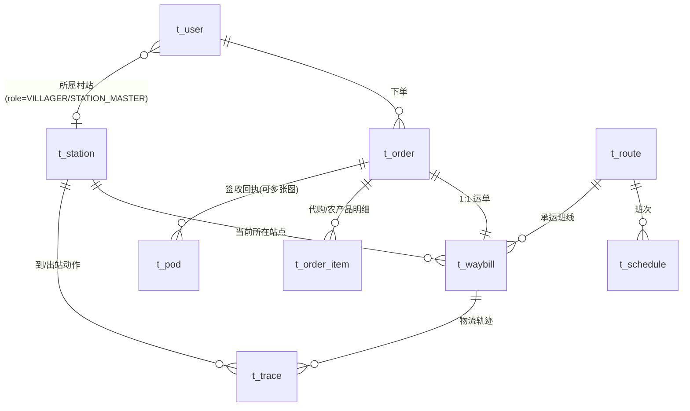

# 乡村情感物流平台 — 数据库设计

> MVP 核心闭环：子女下单（代寄/代购）→ 县域共配定时班线 → 到村入库 → 签收拍照回传 → 农产品上行收件

## 1. ER 总览



## 2. 表清单

| 表 | 说明 | 关键点 |
|----|------|--------|
| `t_station` | 站点三级网络：县域集散中心(COUNTY) / 乡镇 hub(TOWN) / 村级站点(VILLAGE) | `parent_id` 组树；村级站点即"村头合伙人"点位 |
| `t_user` | 用户：子女(SENDER，城里付款人) / 村民(VILLAGER) / 站长(STATION_MASTER) / 运营(OPS) | MVP 用手机号 mock 登录 |
| `t_order` | 订单主表，同时承载下行与上行 | `type`: SEND代寄 / AGENT代购 / AGRI农产品上行；`direction`: DOWN/UP；`status` 见状态机 |
| `t_order_item` | 订单明细（代购商品、上行农产品品类/重量） | |
| `t_waybill` | 运单，与订单 1:1，绑定承运班线 `route_id` 与 `current_station_id` | 轨迹围绕运单记录 |
| `t_trace` | 物流/轨迹事件：下单、揽收、到县、到镇、到村入库、派送、签收 | 前端时间线数据源 |
| `t_pod` | **签收回执（核心差异化）**：签收照片、派送视频、代签人、语音转文字 | 推送给城里子女的"送达朋友圈"素材 |
| `t_route` | 定时班线（农村不需要实时达，固定班线摊薄成本） | `stations` 存站点 id 链，如 `1,2,4,5` |
| `t_schedule` | 班次：班线 + 车牌 + 发车时间 + 状态 | 运营端排班 |

## 3. 订单状态机

### 下行 DOWN（子女下单寄回老家 / 代购送进村）

```
CREATED(已下单) → PICKED(已揽收) → AT_COUNTY(到县域集散)
   → AT_TOWN(到乡镇hub) → AT_VILLAGE(到村站点·派送中) → SIGNED(已签收, 生成 POD)
```

### 上行 AGRI（村民在村站点交寄农产品）

```
VILLAGE_RECEIVED(村站已收) → AT_TOWN → AT_COUNTY → DISPATCHED(发往全网/目的城市)
```

状态推进由站点端动作自动映射：入库扫描（`/inbound`）按站点类型写入 `AT_*`；
签收上传（`/pod`）写入 `SIGNED` 并生成回执记录。

## 4. 关键设计取舍（MVP）

- **不拆快递品牌**：`t_order` 只承载自营"县—村"段；干线（城市→县）通过揽收轨迹模拟，后续接快递公司 B2B 单
- **照片存 URL**（对象存储/CDN），库内 `photos` 为 JSON 数组字符串；MVP 演示页用占位图
- **推送简化为拉取**：子女端"送达朋友圈"轮询 `t_pod`，正式版换 WebSocket/小程序订阅消息
- 金额字段 `DECIMAL(10,2)`；`freight` 运费、`goods_amount` 代购货款分开记，便于分账
